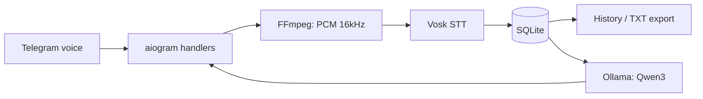

# 🎙 Voice AI Assistant

**Telegram-ассистент для распознавания русской речи и анализа голосовых сообщений с помощью локальной LLM.**

`Python 3.11` · `aiogram 3` · `Vosk` · `FFmpeg` · `SQLite` · `Ollama` · `Qwen3`

> Проект является **расширенной и переработанной open-source реализацией** голосового бота. В текущей версии добавлены персональная история, экспорт, локальные LLM-команды, модульная архитектура, ограничения ресурсов и тесты. Это не заявление, что исходная основа полностью написана заново.

## Возможности

| Команда | Что делает |
|---|---|
| `/start` | Введение |
| `/help` | Список команд |
| `/languages` | Поддерживаемые языки (сейчас русский) |
| `/history` | Последние 10 транскрипций только данного пользователя |
| `/export` | Скачать до 1000 последних транскрипций в UTF-8 TXT |
| `/clear` | Удалить свою историю |
| `/summary` | Пересказ последней транскрипции через локальную Qwen3 |
| `/tasks` | Извлечение поручений/сроков из последней транскрипции |
| `/about` | Технологии и ограничения |
| `/changelog` | Изменения в проекте |
| `/restart` | Перезагрузить Vosk (только для ADMIN_USER_ID) |

Отправь боту голосовое сообщение в **личный чат**, чтобы получить текст. Затем используй `/summary` или `/tasks`.

## Архитектура



```text
voice-ai-assistant/
├── app/
│   ├── main.py                 # Инициализация и polling
│   ├── config.py               # Настройки из .env
│   ├── container.py            # Инъекция зависимостей
│   ├── handlers/
│   │   ├── common.py           # start/help/about/restart
│   │   ├── voice.py            # голосовые сообщения
│   │   ├── history.py          # history/export/clear
│   │   └── ai.py               # summary/tasks
│   ├── services/
│   │   ├── speech_to_text.py   # локальный Vosk
│   │   ├── storage.py          # SQLite
│   │   └── llm_service.py      # Ollama HTTP API
│   └── utils/
│       ├── audio.py            # FFmpeg
│       ├── export.py           # UTF-8 TXT
│       └── messages.py         # разбиение длинных ответов
├── tests/                       # pytest, внешние сервисы замоканы
├── .env.example
├── .gitignore
├── requirements.txt
├── vmr_bot.py                   # совместимый старый способ запуска
└── LICENSE
```

## Быстрый старт на macOS

### 1. Создай окружение

```bash
conda create -n voice-ai -c conda-forge python=3.11 ffmpeg -y
conda activate voice-ai
python -m pip install -r requirements.txt
```

Если окружение `voice-ai` уже существует, **не создавай его повторно**: просто активируй через `conda activate voice-ai`. Проверь `ffmpeg -version`.

### 2. Скачай Vosk-модель

Скачай [vosk-model-small-ru-0.22](https://alphacephei.com/vosk/models) и распакуй папку **`vosk-model-small-ru-0.22`** в корень проекта рядом с `vmr_bot.py`.

### 3. Подготовь Telegram и Ollama

Создай Telegram-бота через [BotFather](https://t.me/BotFather) и сохрани токен в `.env`:

```bash
cp .env.example .env
```

Открой `.env` и замени `your_telegram_bot_token` на настоящий токен. **Никогда не добавляй `.env` в Git.**

Установи [Ollama](https://ollama.com/download/mac), затем:

```bash
ollama pull qwen3:1.7b
ollama list
```

Приложение Ollama должно быть запущено при использовании `/summary` и `/tasks`. Только STT, история и экспорт работают без Ollama.

### 4. Запуск

```bash
python vmr_bot.py
# или:
python -m app.main
```

Для выполнения `/restart` добавь в `.env` свой числовой Telegram ID: `ADMIN_USER_ID=123456789`. Если переменная не заполнена, перезагрузка через чат отключена.

### 5. Тестирование

```bash
python -m pip install pytest
python -m pytest -q
python -m compileall -q app vmr_bot.py
```

Автоматические тесты не требуют API-ключей, Ollama, Vosk-модели или подключения к Telegram: внешние вызовы подменяются заглушками. **Работу Telegram polling и реальное распознавание нужно проверять отдельно на своей машине.**

## Технические решения

- Vosk и FFmpeg выполняются в отдельном потоке (`asyncio.to_thread`), поэтому не блокируют event loop aiogram.
- Локальная модель Vosk загружается **один раз при старте** и используется для каждого нового распознавания.
- LLM-запросы также вынесены в поток; семафор ограничивает параллелизм до одного обращения, чтобы не перегружать Mac.
- Ограничения: голосовые до 180 секунд и 20 МБ; конвертация FFmpeg имеет тайм-аут.
- SQLite хранит сообщения отдельно для каждого Telegram `user_id`; `/history`, `/export`, `/clear`, `/summary` и `/tasks` доступны только в личных чатах.
- Ввод транскрипции в LLM изолируется инструкциями, но защита от prompt injection **не гарантируется**.
- Промежуточные аудиофайлы на диск не сохраняются; база SQLite и модели исключены из Git.

## Приватность и ограничения

**Локальная обработка** означает локальность Vosk, SQLite и Ollama на машине, где запущен бот. При отправке голосового используется инфраструктура Telegram; абсолютной приватности или полной независимости от сети нет. Транскрипции сохраняются без шифрования в `data/transcriptions.db`, пока пользователь не вызовет `/clear` или файл не будет удалён владельцем сервера. Используй тестовый бот и не загружай чувствительные голосовые сообщения в демонстрационную среду.

Текущая версия — **портфолио/MVP**, а не готовая публичная production-платформа. Не реализованы мониторинг, админ-панель, масштабирование на несколько машин и шифрование истории на диске. Маленькая LLM может искажать смысл и пропускать задачи.

## Лицензия

Исходная открытая основа распространялась на условиях **Unlicense**. Текст лицензии включён в репозиторий в `LICENSE`; лицензии используемых моделей, библиотек и других компонентов регулируются отдельно. Не добавляй их файлы в репозиторий без проверки условий.
